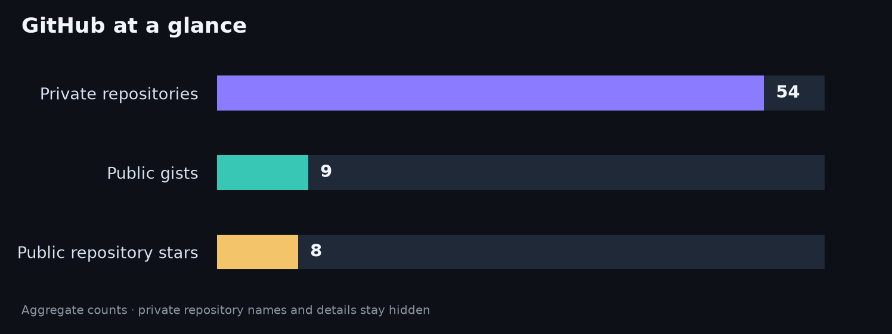

# Hi, I'm Aniruddha Salve

### AI & Full-Stack Engineer · 3.5+ years of experience

I build production-ready software across AI engineering and full-stack development—from system design and MVPs through deployment and iteration. My work includes LLM applications, RAG, AI agents, SaaS products, APIs, and developer tools.

  
  
  
  
  

## About me

- Based in Pune, India.
- Focused on AI products, agentic systems, and reliable full-stack applications.
- Creator of [Dimensia](https://pypi.org/project/dimensia/) and [MeetMorph](https://www.meetmorph.com/).

## Featured work

- **[MeetMorph](https://www.meetmorph.com/)** — Turns meeting transcripts into structured product specifications and shareable working prototypes.
- **[Dimensia](https://pypi.org/project/dimensia/)** — Python library for optimized vector retrieval in LLM and RAG pipelines.
- **[Code Snippet Manager](https://marketplace.visualstudio.com/items?itemName=AniruddhaSalve.code-snippet-manager)** — Create and manage code snippets from VS Code.
- **[MetaHeader](https://marketplace.visualstudio.com/items?itemName=AniruddhaSalve.metaheader)** — Generates standardized file headers across programming languages.
- **[QuizWiz](https://marketplace.visualstudio.com/items?itemName=AniruddhaSalve.quizwiz)** — Practice IT topics with self-quizzes in VS Code.

## Tech stack

  
   
  
   
  
   
  
  

  
  
  
  
  
  
  
  
  
  
  
  
  
  
  
  
  
  
  
  

## GitHub stats

  

  
  

  
  

  

## Research and publications

- **[A Collaborative Multi-Agent Approach to Retrieval-Augmented Generation Across Diverse Data Sources](https://arxiv.org/abs/2412.05838)** — Research on routing queries across heterogeneous data sources with specialized retrieval, reasoning, and generation agents. [Google Scholar](https://scholar.google.com/citations?user=uNlt460AAAAJ&hl=en) · [ORCID](https://orcid.org/0009-0005-0229-9805)
- **[Honeypot Analysis Using Big Data Technologies](https://www.ijsrd.com/articles/IJSRDV11I20035.pdf)** — Analysis of honeypot logs using big-data and security-monitoring techniques.

## Highlights

- Maharashtra State Engineering Design Award (2023), second prize at the ISTE Students’ National Annual Convention.
- First place in the TechGig Data Science Challenge.
- Top 10 in HackerEarth’s “A Perfect Fit” Machine Learning Challenge.
- Runner-up at the institute level in the Avishkar Research Competition (2022).

## Education

**Bachelor of Engineering in Computer Engineering** — Savitribai Phule Pune University, SVPM’s College of Engineering, Baramati (2019–2023)

---

**Let's build something useful with AI and full-stack engineering.**

